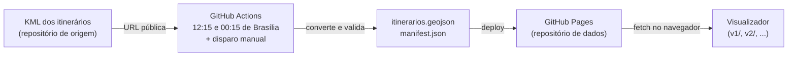

# Visualizador de itinerários do Transcol GV

Visualizador web estático dos itinerários do Transcol GV, para os técnicos da CETURB/ES. Sem back end, publicado no GitHub Pages.

> A raiz do site não tem página. Use o link de cada versão, terminado em `/`.

## Versões

Cada versão é uma subpasta autocontida, com URL própria e README próprio que descreve o que foi implementado nela.

| Versão | Situação | Acesso | Detalhes |
| --- | --- | --- | --- |
| V1 | Piloto, só desktop | <https://ceturb-niad.github.io/transcol-itinerarios-visualizador/v1/> | [`v1/README.md`](v1/README.md) |

Uma versão nova (`v2/`) começa copiando a anterior e não importa nada de outra versão. Assim, cada uma continua funcionando como foi publicada.

## Como o projeto se organiza

Dois repositórios, para poder trocar cada peça sem reescrever a outra:

- **Dados** ([transcol-itinerarios-dados](https://github.com/ceturb-niad/transcol-itinerarios-dados)): converte o KML dos itinerários em GeoJSON e publica no GitHub Pages. Quem edita o KML não muda sua rotina.
- **Visualizador** (este repositório): consome esses arquivos no navegador.



O manifesto traz o número de features, as datas de atualização e verificação e o `hash_origem` do KML. Os dados são baixados inteiros e filtrados no navegador. A defasagem entre editar o KML e ver no mapa é de até cerca de 12 horas.

### Identidade dos dados

Uma linha é o par (`grupo`, `linha`), nunca `linha` sozinha, porque alguns números se repetem entre grupos. Cada itinerário (feature) é identificado por `chave`. O front ignora propriedades desconhecidas, então o contrato de dados cresce sem quebrar versões antigas.

## Estrutura do repositório

```text
.
├── .nojekyll
├── README.md      # este arquivo: visão geral
├── package.json   # scripts de teste e de verificação dos dados
└── v1/            # cada versão: index.html, css/, js/, vendor/, tests/, README.md
```

## Desenvolvimento local

Módulos ES não carregam por `file://`; use um servidor local na raiz do repositório:

```bash
python3 -m http.server 8000
# abrir http://localhost:8000/v1/
```

O desenvolvimento local lê os dados direto das URLs publicadas.

```bash
npm test                  # testes da lógica pura (node --test, sem dependências)
npm run verificar-dados   # confere o contrato dos dados publicados
```

## Publicação

O push no `main` publica. Não há workflow de deploy nem etapa de build.
