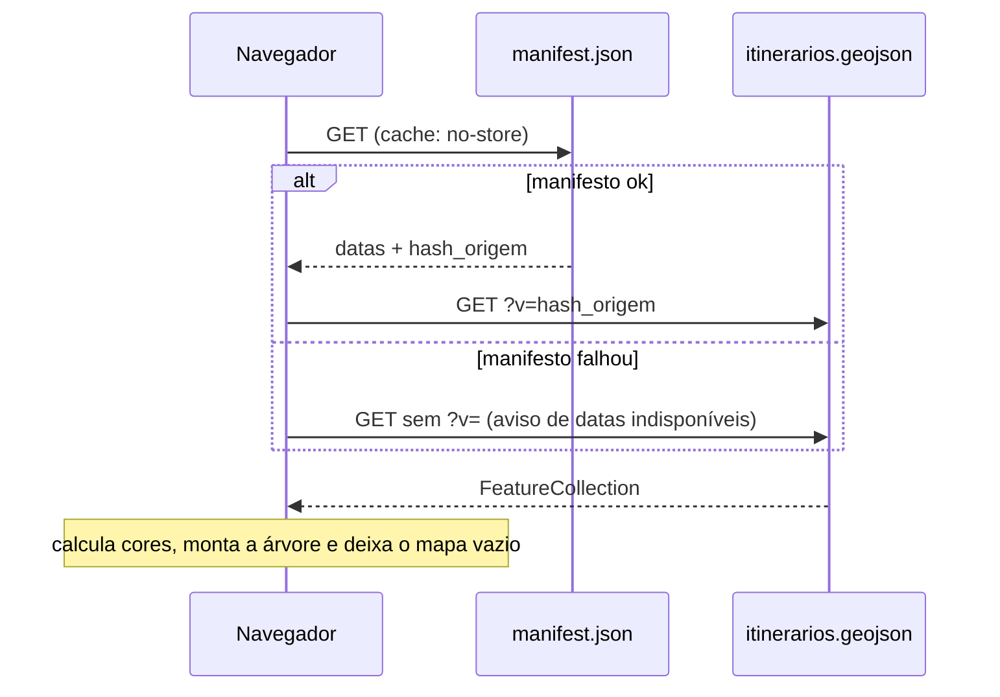
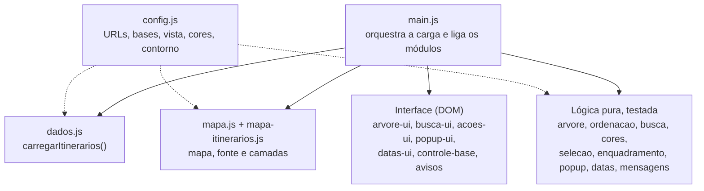

# V1 · Visualizador de itinerários (piloto)

Primeira versão, só para desktop, voltada ao grupo piloto de técnicos da CETURB/ES. Visão geral do projeto, pipeline de dados e identidade das linhas: [README da raiz](../README.md).

**Acesso:** <https://ceturb-niad.github.io/transcol-itinerarios-visualizador/v1/>

## O que a V1 implementa

- Mapa que abre **vazio** sobre o OpenStreetMap, com alternância para imagem de satélite (Esri) mantendo os itinerários ligados.
- Árvore lateral (grupo, subgrupo, linha), recolhida, em ordem alfabética pt-BR; linhas em ordem numérica natural.
- Busca pelo número da linha (ignora maiúsculas e acentos). Não olha `nome` nem `codigo`.
- Seleção por linha (caixa de três estados) ou por itinerário isolado, **Ligar tudo** e **Limpar seleção**. A seleção não persiste ao recarregar.
- Cor determinística por itinerário, calculada no front.
- Popup ao clicar (nome, linha e grupo); passar o mouse não abre.
- Enquadramento do mapa ao ligar, considerando a caixa lateral. Desligar e limpar não movem o mapa.
- Datas de atualização em horário de Brasília, com idade relativa.
- Mensagens de falha na tela, sem `alert()`.

**Fora da V1:** mobile, filtro por município, busca por `nome`/`codigo`, popups elaborados, consulta espacial, camadas de bairro/município, medição de distâncias, marcadores pessoais, edição.

## Stack

| Peça | Escolha |
| --- | --- |
| Interface | HTML, CSS e JavaScript sem framework, módulos ES, sem build |
| Mapa | [MapLibre GL JS](https://maplibre.org/) 6.16.0, copiado em `vendor/maplibre-gl/` (sem CDN) |
| Base do mapa | Tiles raster do OpenStreetMap e do World Imagery (Esri). Sem camadas de texto e sem servidor de fontes |
| Dados | `itinerarios.geojson` e `manifest.json`, de outro repositório |
| Testes | `node --test`, sem dependências, para a lógica pura. Mapa e interface têm roteiro manual |

Pendências conhecidas: o satélite da Esri é provisório até o parecer de licença dos tiles (a tratar no planejamento da V2); o zoom máximo do OSM não tem fonte oficial e usa o padrão do MapLibre.

## Fluxo de carga



Se o GeoJSON falhar, o mapa e os controles continuam na tela, com a árvore vazia e uma mensagem. Todo o acesso a dados fica isolado em `carregarItinerarios()` (`js/dados.js`), para trocar a fonte sem mexer no resto.

## Módulos (`js/`)



Decisões de implementação que ajudam a ler o código:

- **Cores:** os itinerários de um par (`grupo`, `linha`) são ordenados por `nome` (ponto de código); cor = `paleta[(FNV-1a de "grupo|linha" + posição) mod 10]`. Acima de 10 itinerários, o matiz avança pelo ângulo áureo em HSL. A mesma ordem vale para a árvore.
- **Seleção:** conjunto de `chave` ligadas. O mapa tem uma fonte GeoJSON e duas camadas (contorno escuro e linha colorida), filtradas por `chave`. A `chave` nunca vai em `id` de HTML nem em seletor CSS; usa-se `Map` e `data-`.
- **Configuração isolada** em `config.js` (URLs, atribuições, vista inicial, paleta, contorno) e `mensagens.js` (textos).
- **Caminhos relativos** sem barra inicial, para funcionar sob subcaminho. Só as URLs de dados são absolutas.

## Testes e medição

```bash
npm test                  # na raiz do repositório
npm run verificar-dados   # contrato dos dados publicados
```

Medição de desempenho de **Ligar tudo** (opcional): abra a V1 com `?medir` no fim da URL, deixe o mapa parado e rode `await medirSelecao()` no console. Compara dois mecanismos de seleção (filtro por `chave` e reescrita da fonte) e mostra tempo e FPS.
